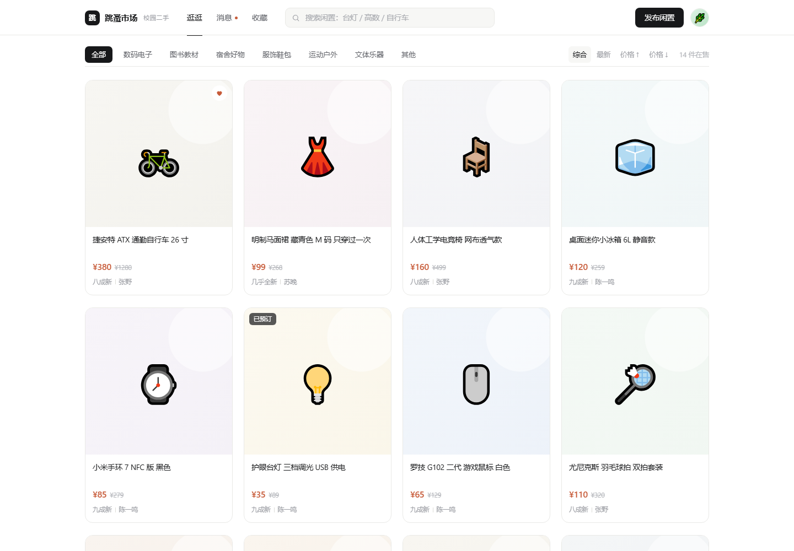
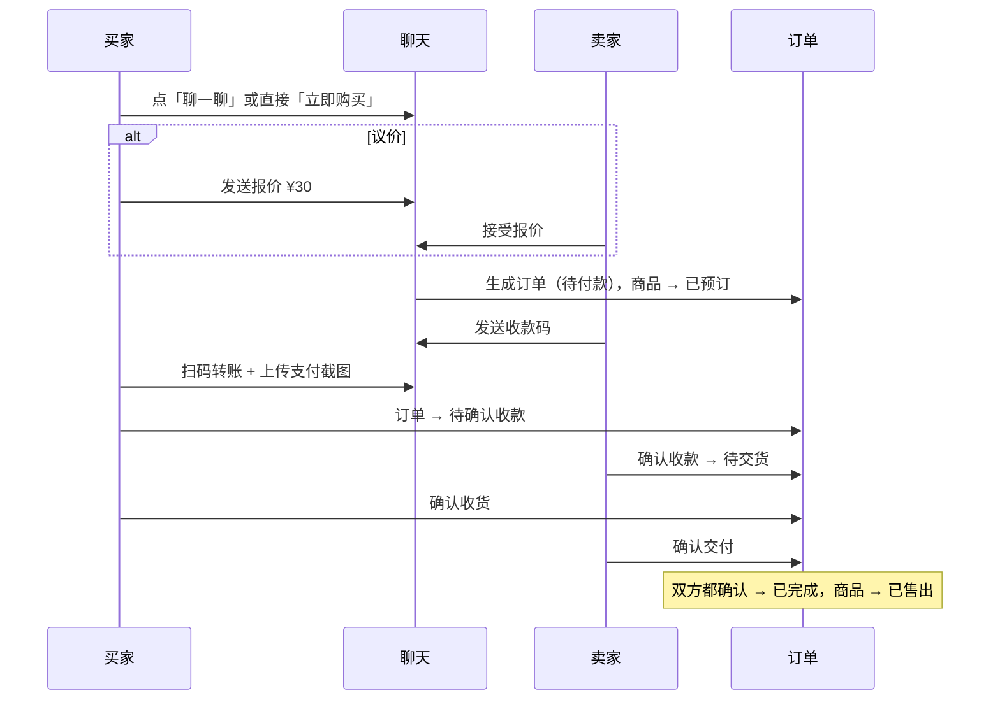
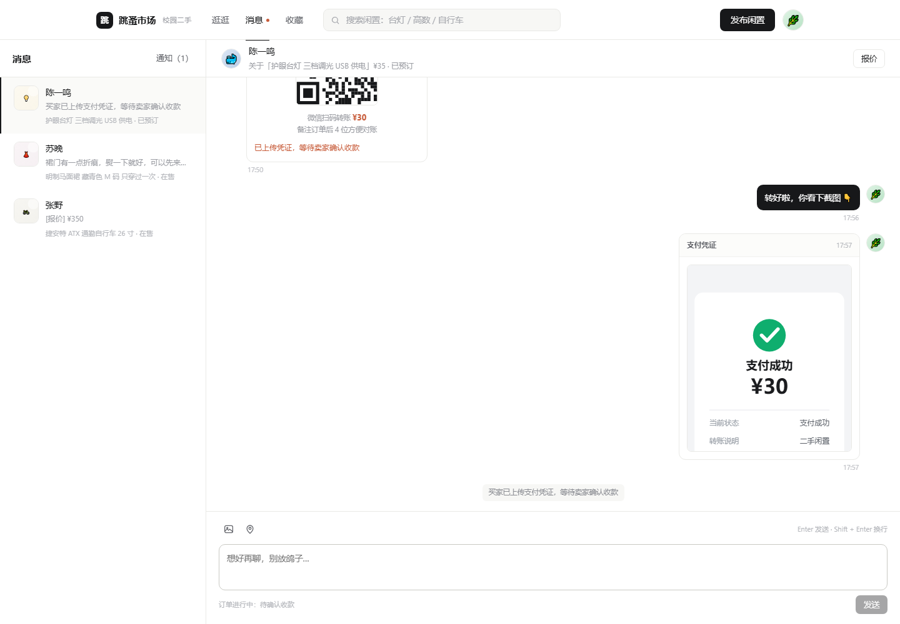
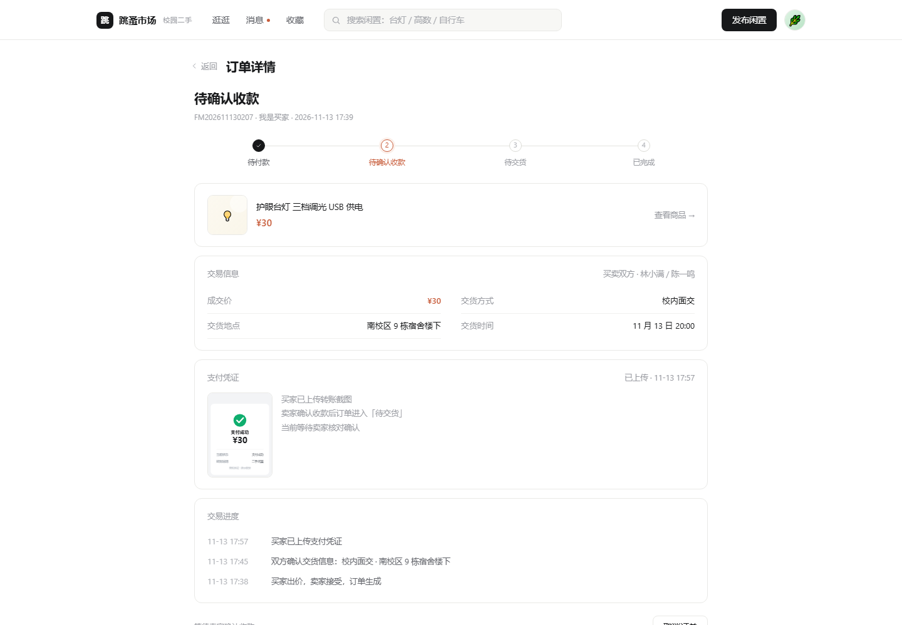
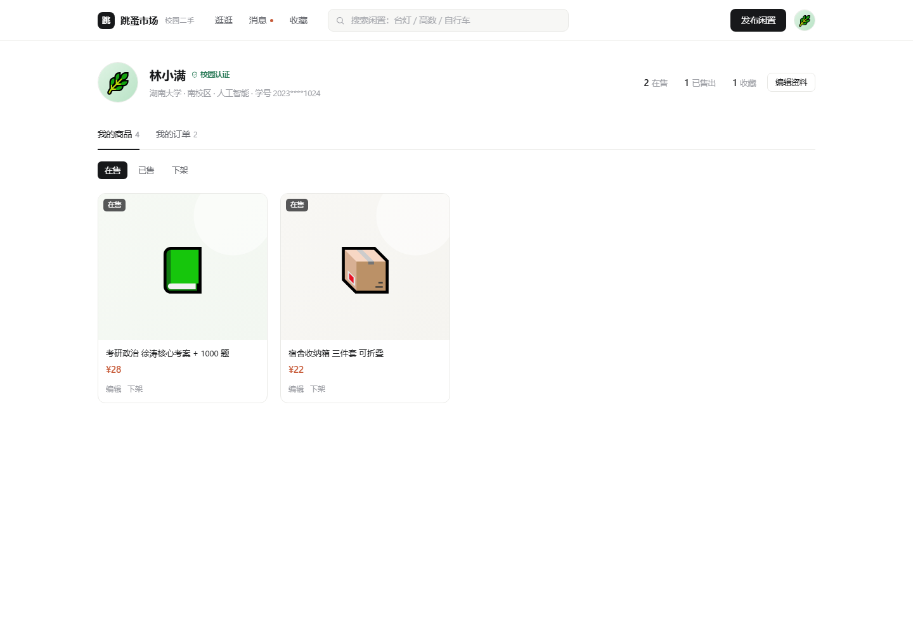
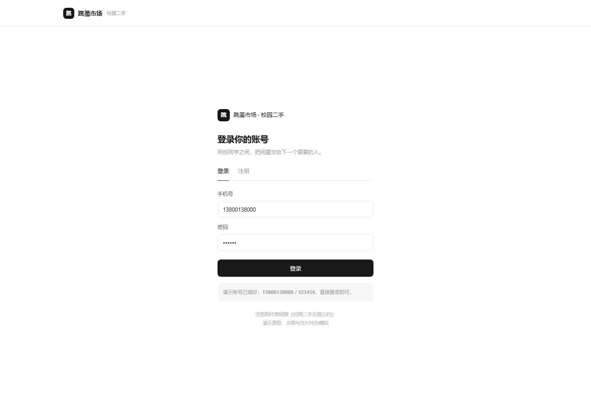

<div align="center">

# 跳蚤市场 · 校园二手交易平台

**能真正跑起来的全栈项目**：Node 服务端 + SQLite 数据库 + 原生 JS 前端，零第三方依赖。

覆盖 **发布商品 → 搜索 → 收藏 → 私聊议价 → 下单 → 收款 → 交货 → 双方确认** 的完整闭环。




</div>

## 快速开始

```bash
node -v          # 需要 >= 22.5（用到内置 SQLite）
npm start        # 启动服务，自动建库并写入演示数据
# 打开 http://localhost:3000
```

**演示账号**：`13800138000` / `123456`（另有 13900139001、13700137002、13600136003，密码相同）
点右上角头像 →「切换演示账号」，可以换成卖家视角接收报价、发收款码、确认收款。

> 数据存在 `server/data/cfm.db`，图片存在 `server/uploads/`，刷新、换浏览器、重开服务都不会丢。
> 想重置：`npm run seed`，或页面里「重置演示数据」。

## 五个关键功能

| 功能 | 入口 | 实现要点 |
| --- | --- | --- |
| **上传商品** | 顶栏「发布闲置」 | 最多 4 张图，前端 canvas 压缩后上传到服务器落盘，商品入库并立刻出现在首页 |
| **搜索** | 顶栏搜索框 / 分类 / 价格排序 | 标题、描述、分类、成色全文匹配，可与分类、排序叠加 |
| **收藏** | 商品卡片悬停的心 / 详情页 | 收藏关系入库；卖家降价后自动给收藏者发「降价提醒」通知 |
| **发消息** | 详情页「聊一聊」 | 双栏聊天，支持文字、图片，以及报价 / 交货信息 / 收款码 / 支付凭证 / 订单五类结构化卡片 |
| **买卖** | 「立即购买」或「聊一聊 → 报价」 | 两条成交通路都会生成订单并锁定商品；付款、收款、交货、双方确认全流程可追踪 |

## 核心流程



**状态机**：商品 `在售 → 已预订 → 已售出`（可下架/上架）；订单 `待付款 → 待确认收款 → 待交货 → 已完成`，任一阶段可取消，预订 15 分钟未付款自动取消并释放商品。规则全部写在服务端，前端无法绕过。

## 技术架构

```
浏览器                          服务端
┌─────────────────────┐        ┌──────────────────────────────┐
│ pages/*.js  纯渲染   │  fetch │ routes.js   REST 路由 + 鉴权  │
│ router.js   页面栈   │ ─────► │ domain.js   业务规则（唯一权威）│
│ store.js    快照缓存 │ ◄───── │ db.js       SQLite（node:sqlite）│
│ api.js      HTTP     │  JSON  │ auth.js     scrypt 口令 + 令牌  │
└─────────────────────┘        └──────────────────────────────┘
```

- **服务端是唯一权威**：所有校验（能否下单、能否确认收款、能否取消）都在 `server/domain.js`，前端只做展示
- **前端零等待渲染**：启动时拉一份快照缓存在内存，页面渲染是同步的；写操作后服务端返回新快照整体替换缓存
- **多端同步**：每 4 秒比对一次版本号，任意一端改动后其它标签页会自动刷新
- **零第三方依赖**：HTTP、SQLite、加密都用 Node 内置模块，`npm i` 都不用跑

### 数据库表

| 表 | 说明 |
| --- | --- |
| `users` | 用户，口令用 scrypt + 随机盐散列存储 |
| `products` | 商品，图片/交货方式以 JSON 存 |
| `favorites` | 收藏关系（user × product 主键） |
| `chats` / `messages` / `chat_reads` | 会话、消息、已读位置（未读数由消息时间推导） |
| `orders` | 订单，含时间线、双方确认标记 |
| `notices` | 通知（降价、订单状态） |
| `sessions` | 登录令牌 |

### API 一览

| 方法 | 路径 | 说明 |
| --- | --- | --- |
| POST | `/api/auth/login` `/register` `/logout` | 登录 / 注册 / 退出 |
| GET | `/api/snapshot` `/api/version` | 拉取全量快照 / 版本号轮询 |
| POST | `/api/upload` | 图片转存，返回 `/uploads/xxx.jpg` |
| POST / PATCH / DELETE | `/api/products` `/api/products/:id` | 发布 / 编辑 / 删除 |
| POST | `/api/products/:id/buy` | **立即购买**（按标价建单） |
| POST | `/api/products/:id/status` `/view` | 上下架 / 浏览计数 |
| POST | `/api/favorites/:id/toggle` | 收藏开关 |
| POST | `/api/chats` `/api/chats/:id/messages` `/read` | 建会话 / 发消息 / 已读 |
| POST | `/api/chats/:id/quotes/:msgId/respond` | 接受或拒绝报价 |
| POST | `/api/orders/:id/proof` `/confirm-payment` `/confirm-receipt` `/cancel` | 订单履约四步 |

## 项目结构

```
campus-flea-market/
├── index.html               # 顶栏 + <main>
├── assets/styles.css
├── server/                  # 服务端（Node 内置模块，零依赖）
│   ├── index.js             # HTTP 服务：静态资源 + /api 路由 + 上传
│   ├── routes.js            # REST 路由表
│   ├── domain.js            # 业务规则：商品/订单/报价/通知/超时
│   ├── db.js                # SQLite 建表与查询封装
│   ├── auth.js              # scrypt 口令 + 会话令牌
│   └── seed.js              # 演示数据（npm run seed 可重置）
├── src/                     # 前端
│   ├── api.js               # HTTP 客户端（Bearer 令牌）
│   ├── store.js             # 快照缓存 + 读写封装
│   ├── router.js            # 页面栈 / 顶栏 / 事件代理
│   ├── app.js               # 启动、轮询同步、引导
│   └── pages/               # auth / home / detail / publish / messages / order / mine
├── shared/placeholder.js    # 商品占位图 / 收款码 / 凭证生成（前后端共用）
├── tests/
│   ├── syntax.js            # 全量语法检查
│   └── api.spec.js          # 49 条 API 集成测试（起真实服务跑完整交易）
└── docs/                    # PRD / 架构说明 / 简历用法
```

## 测试

```bash
npm test          # 语法检查 + API 集成测试，共 49 条断言
```

`tests/api.spec.js` 会启动一个使用临时数据库的真实服务，然后用 `fetch` 跑完整流程：

```
[6] 私聊与报价
  ✓ 不能和自己聊天
  ✓ 卖家接受报价并建单
  ✓ 商品变为已预订
  ✓ 进行中订单时不能再报价

[7] 付款与履约
  ✓ 买家不能确认收款        ← 权限校验
  ✓ 双方确认后订单完成
  ✓ 商品自动变为已售出
```

覆盖登录鉴权、发布、上传、收藏、报价、立即购买、履约四步、取消、越权访问、无效令牌等边界。

## 界面

| 首页 | 商品详情（立即购买 / 聊一聊） |
| --- | --- |
|  |  |

| 消息（双栏聊天 + 卡片） | 订单（四步状态） |
| --- | --- |
|  |  |

| 我的 | 登录 |
| --- | --- |
|  |  |

## 设计取舍

| 决策 | 理由 | 代价 |
| --- | --- | --- |
| 服务端做唯一权威 | 交易状态不能让前端说了算，否则换个客户端就能绕开规则 | 前后端各有一份状态映射 |
| 快照全量下发 | 单校数据量小（几十 KB），换来前端同步渲染和极简的缓存逻辑 | 数据量大了要改增量同步 |
| 零第三方依赖 | 不用装包就能跑，评审/答辩现场不会因为网络挂掉 | 手写路由与 DB 封装 |
| 线下支付 + 凭证 | 学生项目不碰资金池，规避支付合规 | 依赖双方诚信，靠双方确认兜底 |
| 不做评分体系 | 冷启动没有交易量，评分为 0 反而伤害新用户 | 劣质卖家缺少长期约束 |

## Roadmap

- [x] 全栈：Node + SQLite + REST + 图片上传
- [x] 两条成交通路（报价 / 立即购买）、双方确认、超时释放
- [x] 49 条 API 集成测试 + CI
- [ ] WebSocket 实时消息（现在是 4 秒轮询）
- [ ] 举报与申诉、信用分
- [ ] 对象存储 + CDN 替换本地图片目录

## 文档

- [需求文档 PRD](docs/PRD.md)
- [技术方案 ARCHITECTURE](docs/ARCHITECTURE.md)
- [简历与面试用法](docs/RESUME.md)

## License

[MIT](LICENSE) © 2026 yang

> 个人练习作品，演示数据与支付流程均为模拟，不涉及真实资金往来。
