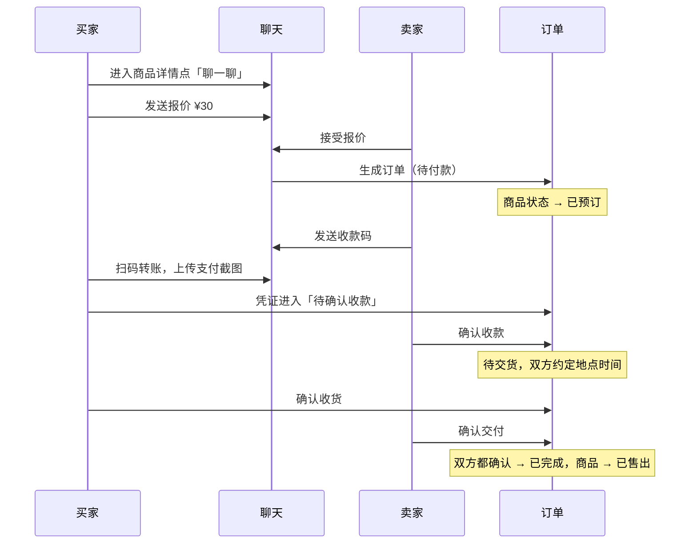
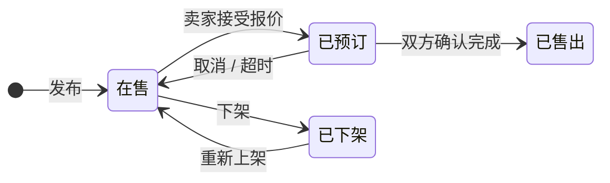
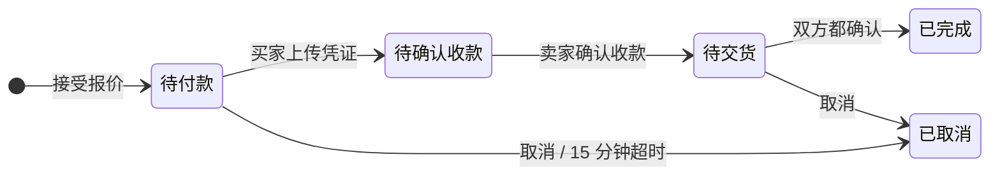
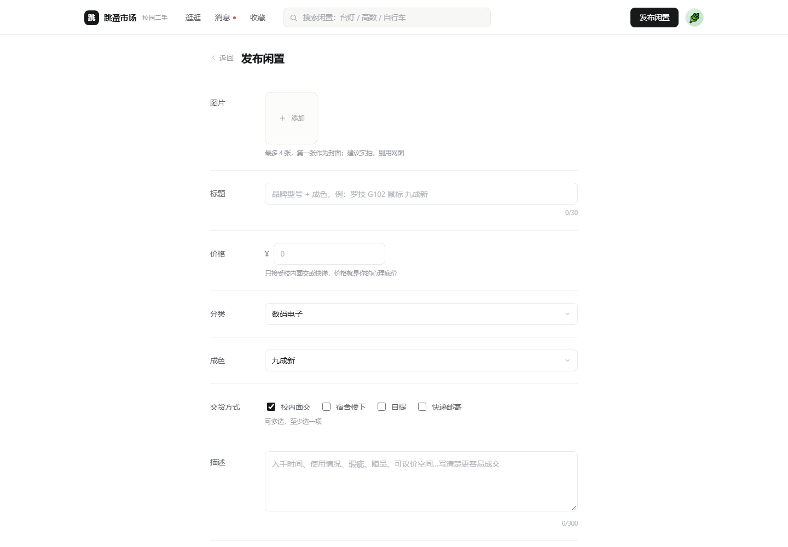

<div align="center">

# 跳蚤市场 · 校园二手交易平台

一个只服务本校的二手交易站点，覆盖 **发布 → 议价 → 下单 → 收款 → 交货 → 双方确认** 的完整闭环。

原生 JS · 零依赖 · 零构建 · 61 条自动化测试


</div>

## 这个项目解决什么问题

校内二手交易大多发生在微信群里：消息刷得快、商品沉底、没法搜索，交易靠口头约定，容易因为「钱付了没」「东西给了没」扯皮。

这个项目把这段流程结构化：

- **可检索**：分类 + 关键词 + 价格排序，商品有状态而不是一条聊天记录
- **可追溯**：报价、收款码、支付凭证、交货信息都是**结构化消息卡片**，聊天记录本身就是交易凭证
- **无歧义**：把「现在该谁操作」抽象成双状态机，双方永远不会互相干等

## 快速开始

```bash
git clone <your-repo-url>
cd campus-flea-market

# 方式一：直接双击 index.html（无需任何环境）

# 方式二：本地服务（推荐，避免个别浏览器的 file:// 限制）
npm run dev        # http://localhost:8080
```

**演示账号**：`13800138000` / `123456`（登录页已预填）。
点右上角头像 →「切换演示账号」，换成「陈一鸣」即可体验卖家视角：接收报价、发收款码、确认收款。

> 数据保存在浏览器 localStorage，刷新不丢；弹窗底部可一键重置。
> 调试入口：`index.html?p=order&id=o_demo2` 可直接打开任意页面，`&guide=0` 跳过引导。

## 功能

| 模块 | 能力 |
| --- | --- |
| 账号 | 注册登录、学号校园认证、个人主页（在售/已售，不展示评分）、编辑资料 |
| 商品 | 发布（多图/标题/价格/分类/成色/描述/交货方式）、编辑、上下架、删除 |
| 逛逛 | 分类、关键词搜索、综合/最新/价格升降排序、详情多图切换 |
| 私聊 | 文字与图片、**报价卡片**（出价/还价/接受/拒绝）、交货信息卡片、收款码、支付凭证、订单卡片 |
| 收藏 | 收藏/取消、收藏列表、**降价提醒**（进通知中心） |
| 交易 | 下单、凭证确认、交货确认、双方确认完成、主动取消、15 分钟超时自动取消 |
| 通知 | 降价提醒、订单状态变更，可直达对应订单/商品 |

## 核心流程



## 状态设计

商品 4 态、订单 4 态（含 2 个终态）。**订单是主，商品跟随订单**——所有流转都有守卫，不依赖 UI 是否禁用按钮。





## 技术要点

**架构分层**（详见 [docs/ARCHITECTURE.md](docs/ARCHITECTURE.md)）

```
index.html  顶栏 + <main id="view">
   └─ router.js     页面栈 / 顶栏同步 / data-act 事件代理
        └─ pages/*.js    render(params) → HTML 字符串（纯函数）
             └─ store.js    业务规则 · 状态机 · 持久化（唯一写入口）
                  └─ localStorage
```

几个刻意的取舍：

| 决策 | 理由 | 代价 |
| --- | --- | --- |
| 不引入框架 | 7 个页面、状态集中在少数实体，更需要「流转清晰」而非框架抽象 | 全量重渲染，需手动保滚动 |
| 业务收敛到 store 单点 | 状态机最容易被写乱，收口后可脱离 DOM 测试 | 单文件偏大（600 行） |
| 事件代理 + `data-act` | 重渲染后事件不丢，模板里不用逐个绑定 | 动作命名要约定 |
| 图片 canvas 二次压缩 | 原图直接进 localStorage 会立刻爆 5MB 配额 | 画质有损，最长边 900px |
| 占位图用 SVG Data URI | 离线可跑、仓库体积几乎为 0 | 不是真实照片 |
| 超时用「读时补偿」 | 页面不开也要能取消，`tick()` 在启动/轮询时补算 | 最多延迟几秒 |

## 项目结构

```
campus-flea-market/
├── index.html               # 顶栏骨架 + 脚本加载顺序
├── assets/styles.css        # 设计变量 + 组件 + 响应式
├── src/
│   ├── ui.js                # 图标 / toast / 弹窗 / 图片压缩
│   ├── seed.js              # 演示数据 + SVG 占位图 / 收款码 / 凭证
│   ├── store.js             # 业务与状态机（唯一写入口）
│   ├── router.js            # 页面栈 / 顶栏 / 事件代理
│   ├── app.js               # 启动、搜索、倒计时、引导
│   └── pages/               # auth / home / detail / publish / messages / order / mine
├── tests/
│   ├── harness.js           # Node 里的 DOM 桩 + 加载器 + 断言
│   ├── syntax.js            # 全量 node --check
│   └── run.js               # 61 条业务与渲染断言
├── docs/
│   ├── PRD.md               # 需求文档：角色、优先级、验收标准
│   ├── ARCHITECTURE.md      # 架构、状态机、设计决策
│   └── RESUME.md            # 这个项目怎么写在简历上、面试怎么讲
├── scripts/serve.js         # 零依赖静态服务器
└── .github/workflows/       # CI（测试）+ GitHub Pages 部署
```

## 测试

```bash
npm test              # 语法检查 + 业务回归，共 61 条断言
npm run test:logic    # 只跑业务与渲染
npm run test:syntax   # 只跑语法检查
```

没有引入测试框架，用 Node 自带能力搭了最小基座：桩掉 `window` / `document` / `localStorage`，按顺序加载浏览器脚本。

因为 `render()` 是纯函数（只返回字符串），所以能**脱离浏览器断言每种状态的输出**：

```
[6] 交货与双方确认
  ✓ 卖家确认交付
  ✓ 仅一方确认时订单未完成
  ✓ 买家确认收货
  ✓ 双方确认后订单完成
  ✓ 商品自动变为已售出
```

此外每轮改动都会用无头浏览器逐页截图并抓控制台异常——静态渲染测试会漏「只在某个条件分支里执行」的未定义变量，这是实打实踩过的坑。

## 界面

| 首页 | 商品详情 |
| --- | --- |
|  |  |

| 消息（双栏聊天） | 订单 |
| --- | --- |
|  |  |

| 我的 | 发布 |
| --- | --- |
|  |  |

设计取向：白底 + 1px 浅灰描边，无阴影无渐变；只保留一个强调色（价格 / 进行中状态）；一屏只有一个实心主按钮，其余交给文字链接与图标。

## Roadmap

- [x] 完整交易闭环（报价 → 凭证 → 交货 → 双方确认）
- [x] 收藏降价提醒、通知中心
- [x] 响应式布局、零依赖自动化测试、CI
- [ ] 后端 API（Node + SQLite）+ JWT 登录
- [ ] WebSocket 实时消息与未读推送
- [ ] 迁移 TypeScript，store 拆分为 domain / service
- [ ] 图片对象存储 + CDN
- [ ] 举报、申诉、信用分

## 文档

- [需求文档 PRD](docs/PRD.md)
- [技术方案 ARCHITECTURE](docs/ARCHITECTURE.md)
- [简历与面试用法](docs/RESUME.md)

## License

[MIT](LICENSE) © 2026 yang

> 本项目为个人练习作品，演示数据与支付流程均为模拟，不涉及真实资金往来。
