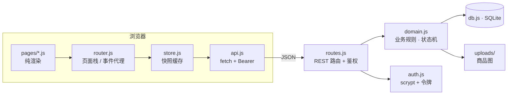
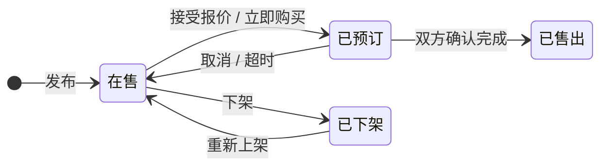
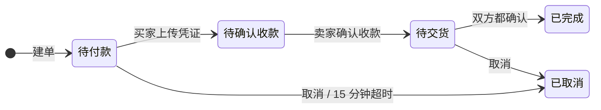

# 技术方案

## 1. 总体架构

前后端分离的**同源单体**：Node 进程既提供静态页面，也提供 `/api` 接口；数据库用 Node 内置的 SQLite（`node:sqlite`）。全项目零第三方依赖。



| 层 | 文件 | 职责 | 不该做的事 |
| --- | --- | --- | --- |
| 页面 | `src/pages/*.js` | `render()` 返回 HTML 字符串、派发动作 | 不判断业务合法性 |
| 路由 | `src/router.js` | 页面栈、顶栏状态、`data-act` 事件代理 | 不碰数据 |
| 缓存 | `src/store.js` | 同步读快照、异步写接口 | 不实现业务规则 |
| 接口 | `server/routes.js` | 路由匹配、鉴权、参数透传 | 不写业务规则 |
| 领域 | `server/domain.js` | **唯一权威**：状态机、校验、通知、超时 | 不碰 HTTP/HTML |
| 存储 | `server/db.js` | SQLite 建表、查询封装、版本号 | 不含业务语义 |

## 2. 请求与渲染

```
启动 → GET /api/snapshot（全量快照）→ 存内存 → 同步渲染首页
点击 → 事件代理 → 动作 → POST /api/xxx → 服务端校验并写库 → 返回新快照
     → 整体替换缓存 → 重新渲染
```

- **渲染是同步的**：页面只读内存快照，所以没有 loading 态和异步渲染的复杂度
- **写操作必须过服务端**：前端不做"看起来能点"的假按钮，越权操作会收到 403
- **多端同步**：每 4 秒 `GET /api/version`，版本变了就重拉快照并刷新当前页（输入框聚焦时跳过，避免打断打字）

## 3. 状态机

商品与订单互相驱动，**订单是主、商品跟随订单**；所有流转都在 `domain.js` 的守卫里。





关键守卫（都在服务端，前端无法绕过）：

- 只有 `on_sale` 的商品能被下单；同一商品同时最多一个进行中订单
- `confirmPayment` 只有卖家能调；`uploadProof` 只有买家能调；`confirmReceipt` 按角色写对应的一方
- **必须两方都确认**才置为完成并让商品变已售出
- 任何取消都要把商品回滚到在售并写时间线

## 4. 数据与鉴权

- 口令：`scrypt(pwd, salt)` 存散列 + 随机盐，登录用 `timingSafeEqual` 比较
- 会话：登录生成 32 字节随机令牌存 `sessions` 表，前端放 `localStorage`，请求带 `Authorization: Bearer`
- 图片：前端 canvas 压缩（最长边 900，JPEG 0.75）→ `POST /api/upload`（base64）→ 服务端落盘 `server/uploads/`，数据库只存 URL，避免快照体积膨胀
- 未读数：不存计数器，用 `chat_reads.last_read_at` 与消息时间推导，避免并发下计数错乱

## 5. 关键取舍

| 决策 | 理由 | 代价 |
| --- | --- | --- |
| 业务只写在服务端 | 交易状态不能让客户端说了算；换客户端也绕不过规则 | 前后端各有一份状态映射 |
| 全量快照而非增量 | 单校数据几十 KB，换来渲染同步与缓存逻辑极简 | 数据量大了要改增量/分页 |
| 轮询而非 WebSocket | 4 秒一次版本号几乎无成本，实现简单 | 有最多 4 秒延迟 |
| 零依赖 | 现场演示不依赖网络装包；SQLite 用 Node 内置 | 手写路由与 DB 封装 |
| 线下支付 + 凭证 | 不碰资金池，规避支付合规 | 依赖双方诚信，用双方确认兜底 |

## 6. 测试

| 文件 | 作用 |
| --- | --- |
| `tests/syntax.js` | 对 `src/`、`server/`、`shared/`、`scripts/` 全量 `node --check` |
| `tests/api.spec.js` | 起真实服务（临时数据库），用 fetch 跑 49 条断言 |

覆盖：登录鉴权、密码错误、发布校验、图片上传落盘、收藏计数、会话创建、报价与接受、重复报价拦截、凭证/收款/双方确认、立即购买、取消回滚、越权编辑、无效令牌、已售商品重复购买。

## 7. 演进路线

| 阶段 | 内容 |
| --- | --- |
| v1.1 | WebSocket 替换轮询，做实时消息与未读推送 |
| v1.2 | 图片走对象存储 + CDN；快照改增量同步 |
| v1.3 | 举报/申诉、信用分；管理后台 |
| v1.4 | 迁移 TypeScript，抽 domain 为共享包（前后端复用类型） |
