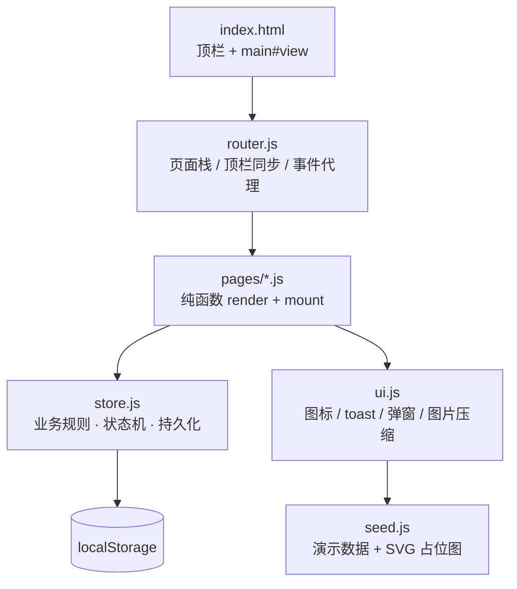
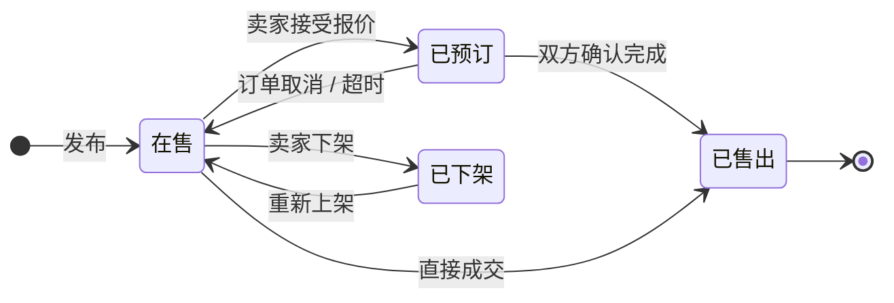
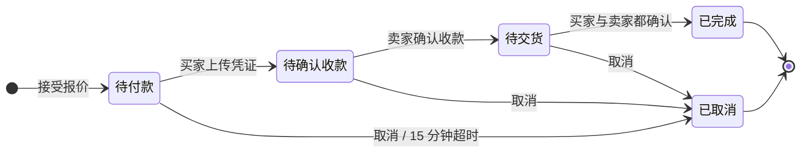

# 技术方案

## 1. 总体架构

纯静态单页应用，浏览器直接运行，没有构建步骤、没有第三方依赖。



| 层 | 文件 | 职责 | 不该做的事 |
| --- | --- | --- | --- |
| 入口 | `index.html` | 顶栏骨架、脚本加载顺序 | 不写业务逻辑 |
| 路由 | `router.js` | 页面栈、顶栏状态、全局点击代理 | 不碰业务数据 |
| 页面 | `src/pages/*.js` | 渲染 HTML 字符串、绑定事件、派发动作 | 不直接改 DB，只调 store |
| 业务 | `src/store.js` | 所有状态流转、校验、通知、持久化 | 不碰 DOM |
| 基础 | `src/ui.js` | 图标、格式化、toast、弹窗、图片压缩 | 不含业务语义 |
| 数据 | `src/seed.js` | 演示数据与占位图生成 | 只在首次启动使用 |

## 2. 状态机

商品与订单是两套互相驱动的状态机，**订单是主，商品跟随订单**。





关键约束（都写在 `store.js` 的守卫里，不依赖 UI）：

- 只有 `on_sale` 的商品能被报价接受
- 同一商品同时最多一个进行中订单
- `confirmReceipt` 按调用者角色写入对应的一方，**必须两方都写满**才置为完成
- 任何一次取消都要把商品回滚到在售，且写一条时间线

## 3. 关键设计决策

| 决策 | 为什么 | 代价 |
| --- | --- | --- |
| 不引入框架，字符串模板渲染 | 项目规模小（7 页），框架的抽象成本高于收益；便于面试时逐行解释 | 全量重渲染，需要手动保滚动位置 |
| 业务全部收敛到 `store.js` | 状态机是这类项目最容易写乱的地方；单点收口后可以脱离 DOM 测试 | 文件偏大（600 行） |
| localStorage 作持久层 | 无需后端即可完整演示；面试现场无网络也能跑 | 5MB 上限，图片必须压缩 |
| 事件代理 + `data-act` | 模板里不用记每个元素的事件，重渲染后事件不丢 | 动作注册散在各页面文件，需要约定命名 |
| 上传图片走 canvas 二次压缩 | 直接把原图存 localStorage 会立刻爆配额 | 画质有损，最大边 900px |
| 占位图用 SVG Data URI | 不依赖外链图片，仓库可离线运行，体积几乎为 0 | 不是真实照片 |
| 超时用「读时补偿」而非定时器 | 页面没开也要能取消，所以 `tick()` 在每次启动和轮询时补算 | 最多延迟几秒才反映 |

## 4. 渲染与事件

```
用户点击 → document 上的委托监听 → 读 data-act → 查 CFM.actions[action] → 执行 → router.refresh()
```

- **页面渲染**：`render(params) -> html string`，纯函数，可脱离浏览器测试
- **挂载钩子**：`mount(params, isRefresh)` 处理输入框、自动滚动、聚焦等副作用
- **刷新策略**：动作执行后整页 `innerHTML` 重绘；聊天、列表会保留滚动位置
- **动作命名**：`模块.动作`，例如 `chat.acceptQuote`、`order.confirmPay`、`mine.tab`

## 5. 图片处理

```
用户选择文件 → FileReader → Image → canvas 等比缩放（最长边 900）→ toDataURL(jpeg, 0.75)
```

单张约 60–100KB，4 张封顶；写入 localStorage 时捕获 `QuotaExceededError` 并提示用户清理。

## 6. 测试策略

没有引入测试框架（避免依赖），用 Node 自带能力搭了一个最小基座：

| 文件 | 作用 |
| --- | --- |
| `tests/harness.js` | 构造 `window` / `document` / `localStorage` 桩，按顺序加载浏览器脚本，提供 `describe/ok/summary` |
| `tests/syntax.js` | 对 `src/`、`scripts/` 下所有 JS 跑 `node --check` |
| `tests/run.js` | 61 条断言：数据层状态流转 + 16 个页面/状态的渲染 |

**为什么能测页面？** 因为 `render()` 只返回字符串，不依赖真实 DOM；把 store 和 seed 加载进来就能对每种状态断言输出。

**补充手段**：用无头浏览器逐页截图并抓控制台异常，能发现「只在某个条件分支里执行」的未定义变量——静态渲染测试和这个结合才够。

## 7. 演进路线

| 阶段 | 内容 | 价值 |
| --- | --- | --- |
| v1.1 | 接入 TypeScript（JSDoc 先行），拆分 store 为 domain 层 | 类型安全，团队协作 |
| v1.2 | Node + SQLite 轻量 API，JWT 登录 | 变成真正的全栈项目 |
| v1.3 | WebSocket 实时消息与未读推送 | 体现实时系统经验 |
| v1.4 | 图片走对象存储 + CDN，Redis 缓存热门列表 | 工程化上线能力 |
| v2.0 | 举报、申诉、信用分 | 平台治理 |
